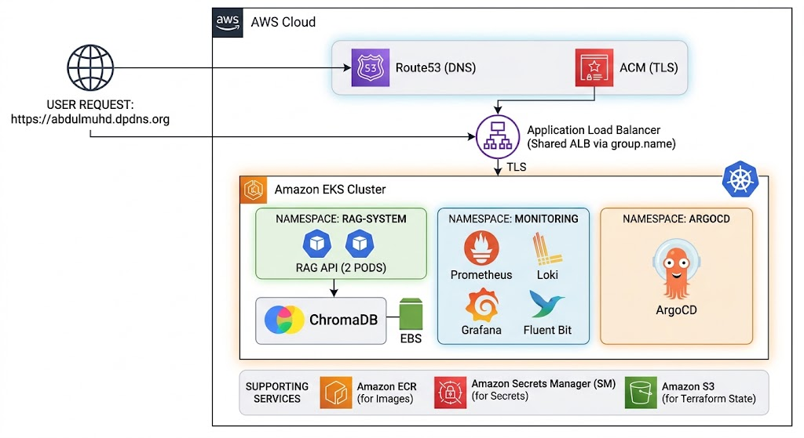
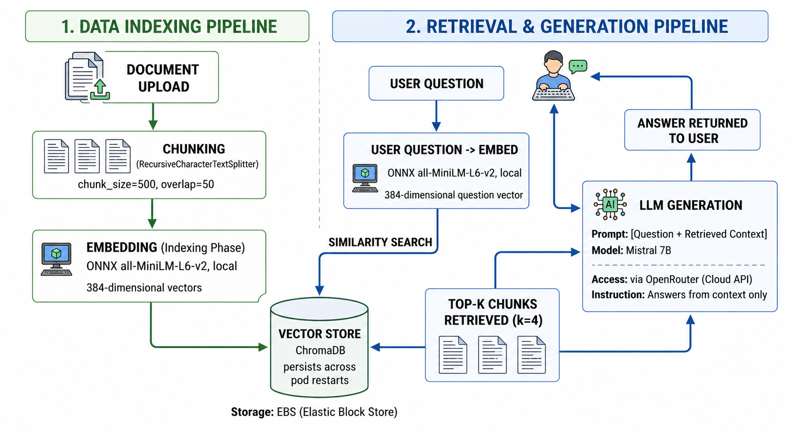
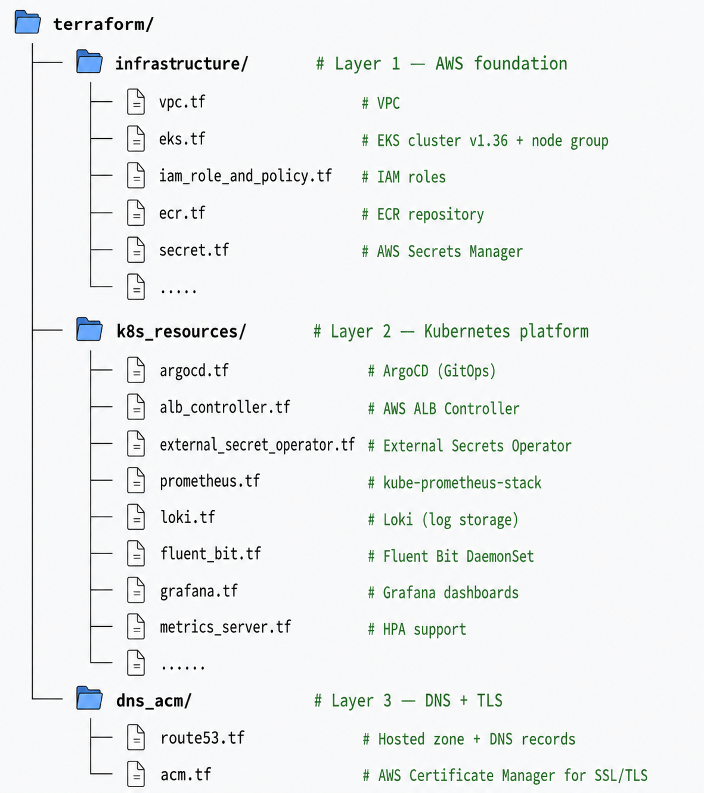
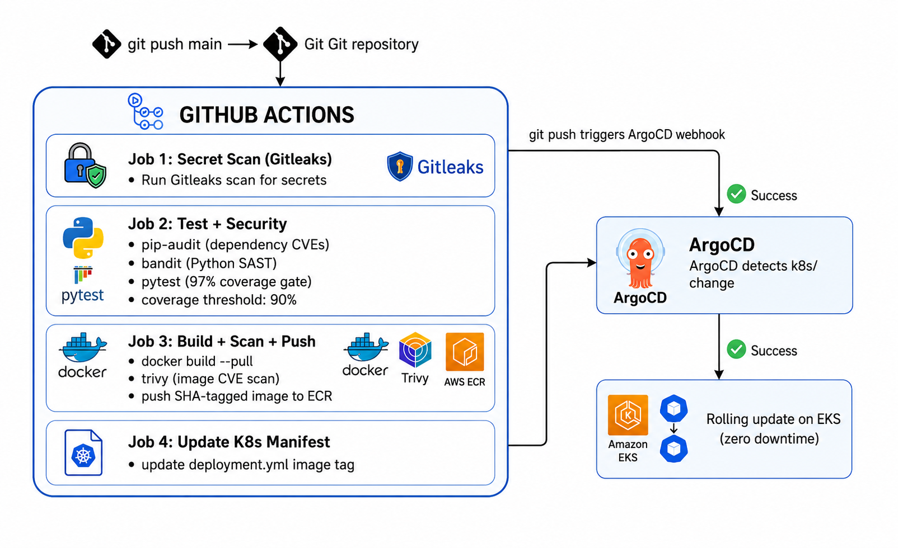
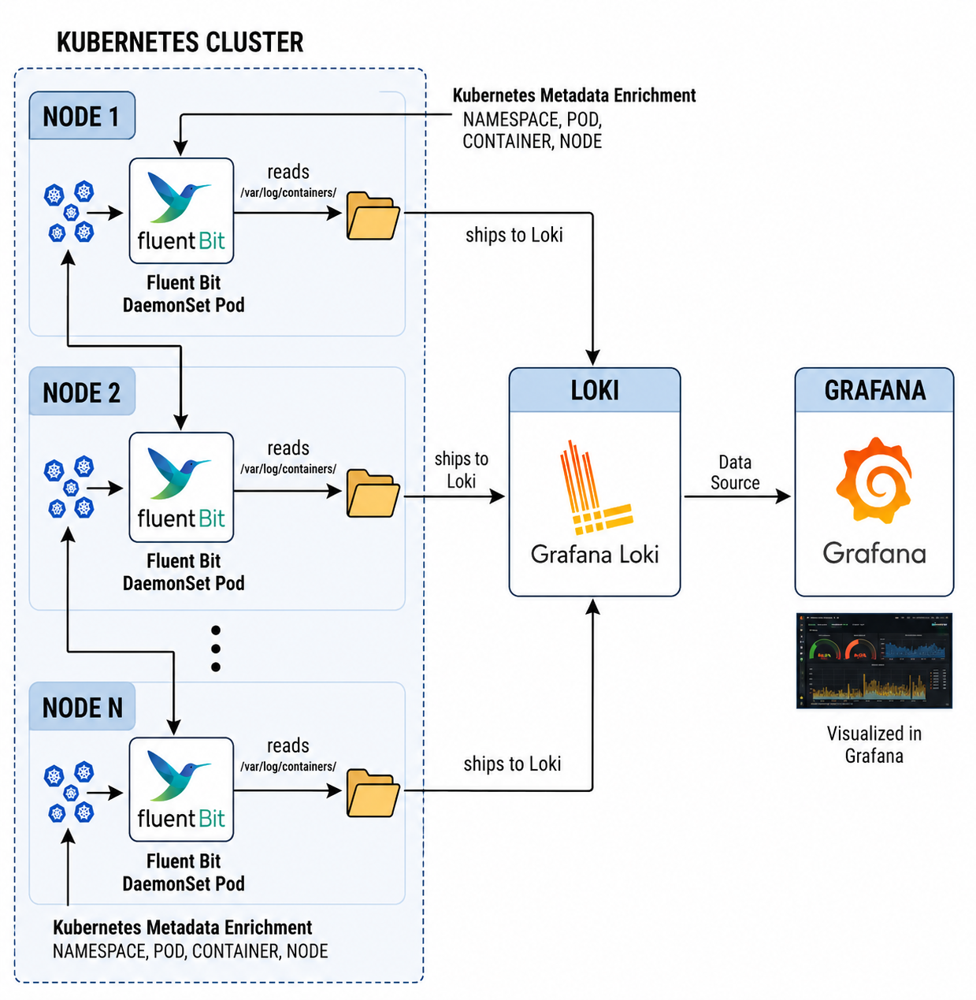
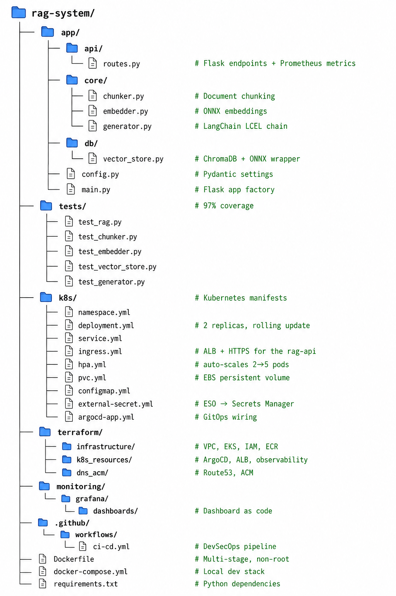

## RAG System — Production AI Platform

A production-grade Retrieval-Augmented Generation (RAG) system
built with LangChain, ChromaDB, and Flask. Fully deployed on
AWS EKS with GitOps, observability, and a complete DevSecOps
CI/CD pipeline.

---

## 🏗️ Architecture


---

## 🛠️ Tech Stack

| Layer | Technology |
|-------|-----------|
| AI/RAG | LangChain, ChromaDB, OpenRouter |
| Embeddings | ONNX Runtime (all-MiniLM-L6-v2, local) |
| API | Flask + Gunicorn |
| Container | Docker (multi-stage, non-root, 934MB) |
| Orchestration | Kubernetes (AWS EKS v1.36) |
| IaC | Terraform (3 layers) |
| GitOps | ArgoCD |
| CI/CD | GitHub Actions (OIDC, no long-lived credentials) |
| Secrets | AWS Secrets Manager + External Secrets Operator |
| Ingress | AWS ALB Controller |
| DNS | Route53 + DigitalPlat |
| TLS | AWS ACM |
| Metrics | Prometheus + kube-prometheus-stack |
| Logs | Fluent Bit (DaemonSet) + Loki |
| Dashboard | Grafana |
| Registry | Amazon ECR |

---

## 🔄 RAG Pipeline


---

## 🏗️ Infrastructure — 3 Terraform Layers


### Deploy Order

```bash
# provision steps 
cd terraform/infrastructure && terraform apply
cd terraform/k8s_resources  && terraform apply
cd terraform/dns_acm        && terraform apply
cd <project root directory> && kubectl apply -f k8s/argocd-app.yml

# destroy (reverse order)
kubectl delete application rag-api -n argocd 
cd terraform/dns_acm        && terraform destroy
cd terraform/k8s_resources  && terraform destroy
cd terraform/infrastructure && terraform destroy
```
---

## 🔐 Security

| Layer | Implementation |
|-------|----------------|
| CI/CD auth | OIDC federation (no long-lived AWS credentials) |
| Pod AWS access | IRSA (IAM Roles for Service Accounts) |
| Secrets | External Secrets Operator → AWS Secrets Manager |
| Container | Non-root user, dropped Linux capabilities |
| Image scanning | Trivy (blocks CRITICAL/HIGH CVEs) |
| Code scanning | Bandit (Python SAST) |
| Dependency scanning | pip-audit (CVE detection) |
| Secret scanning | Gitleaks (pre-push) |
| Network | EKS nodes in private subnets only |
| TLS | ACM wildcard cert, HTTP → HTTPS redirect |

---

## ♾️ CI/CD Pipeline


---

## 📊 Observability
### Metrics (Prometheus)
Custom RAG metrics exposed at /metrics endpoint:

| Metric | Type | Description |
|--------|------|-------------|
| `rag_questions_asked_total` | Counter | Total questions asked |
| `rag_answer_latency_seconds` | Histogram | LLM response latency (p50/p90/p99) |
| `rag_documents_ingested_total` | Counter | Documents ingested by file type |
| `rag_chunks_created_total` | Counter | Total chunks created |
| `rag_ingestion_errors_total` | Counter | Failed ingestions |
| `rag_question_errors_total` | Counter | Failed questions |
| `rag_active_requests` | Gauge | Concurrent requests |

### Logs (Fluent Bit → Loki)
Fluent Bit DaemonSet
  → reads /var/log/containers/ on every node
  → enriches with K8s metadata
    (namespace, pod, container, node)
  → ships to Loki
  → visualized in Grafana



### Dashboard

Grafana: "View Dashboard" (https://abdulmuhd.dpdns.org/admin/grafana)

The dashboard provides the following monitoring features:

- System Health
  - Pod status and replica count
  - HPA scaling activity
- LLM Performance
  - Latency percentiles (p50, p90, p99)
  - Request rate and error rate
- Resource Utilization
  - Pod CPU and memory usage per pod
  - Node CPU usage
- Document Ingestion
  - Document ingestion metrics by file type
- Logging
  - Live log stream
  - Error log filtering

---

## 📁 Project Structure


---

## 🌐 Live Endpoints

| Endpoint | Description |
|----------|-------------|
| `GET /api/v1/health` | Liveness probe |
| `POST /api/v1/ingest` | Upload + index document |
| `POST /api/v1/ask` | Ask a question |
| `GET /metrics` | Prometheus metrics |
| `/admin/argocd` | ArgoCD UI |
| `/admin/grafana` | Grafana dashboard |

---

## ⚡ Quick Start 
### Local Development 

```bash
# clone
git clone https://github.com/abdulmuhd-dev/RAG-system
cd RAG-system

# setup
cp .env.example .env
# add your OPENROUTER_API_KEY to .env

# run locally
docker compose up -d

# test
curl http://localhost:8000/api/v1/health
```
### Run Tests

```bash
python -m venv .venv
source .venv/bin/activate
pip install -r requirements.txt
pytest  # runs with 90% coverage gate
```
### Deploy To EKS

```bash
# provision infrastructure
cd terraform/infrastructure && terraform apply
cd terraform/k8s_resources  && terraform apply
cd terraform/dns_acm        && terraform apply

# deploy app (ArgoCD handles this automatically on git push)
kubectl apply -f k8s/argocd-app.yml
```
