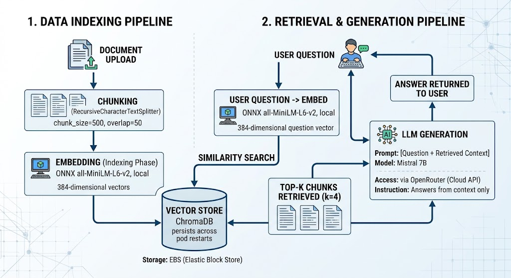

# RAG System — Production AI Platform

A production-grade Retrieval-Augmented Generation (RAG) system
built with LangChain, ChromaDB, and Flask. Fully deployed on
AWS EKS with GitOps, observability, and a complete DevSecOps
CI/CD pipeline.

---

## 🏗️ Architecture

---

## 🛠️ Tech Stack

| Layer | Technology |
|-------|-----------|
| AI/RAG | LangChain, ChromaDB, OpenRouter |
| Embeddings | ONNX Runtime (all-MiniLM-L6-v2, local) |
| API | Flask + Gunicorn |
| Container | Docker (multi-stage, non-root, 934MB) |
| Orchestration | Kubernetes (AWS EKS v1.36) |
| IaC | Terraform (3 layers) |
| GitOps | ArgoCD |
| CI/CD | GitHub Actions (OIDC, no long-lived credentials) |
| Secrets | AWS Secrets Manager + External Secrets Operator |
| Ingress | AWS ALB Controller |
| DNS | Route53 + DigitalPlat |
| TLS | AWS ACM |
| Metrics | Prometheus + kube-prometheus-stack |
| Logs | Fluent Bit (DaemonSet) + Loki |
| Dashboard | Grafana |
| Registry | Amazon ECR |

---

## 🔄 RAG Pipeline

---

## 🏗️ Infrastructure — 3 Terraform Layers

terraform/
├── infrastructure/     # Layer 1 — AWS foundation
│   ├── vpc.tf          # VPC
│   ├── eks.tf          # EKS cluster v1.36 + node group
│   ├── iam_role_and_policy.tf          # IAM roles 
│   ├── ecr.tf          # ECR repository
│   ├── secret.tf       # AWS Secrets Manager
│   └── ..... 
│
├── k8s_resources/      # Layer 2 — Kubernetes platform
│   ├── argocd.tf       # ArgoCD (GitOps)
│   ├── alb_controller.tf  # AWS ALB Controller
│   ├── external_secret_operator.tf # External Secrets Operator
│   ├── prometheus.tf   # kube-prometheus-stack
│   ├── loki.tf         # Loki (log storage)
│   ├── fluent_bit.tf   # Fluent Bit DaemonSet
│   ├── grafana.tf      # Grafana dashboards
│   ├── metrics_server.tf  # HPA support
│   └── ...... 
│
└── dns_acm/            # Layer 3 — DNS + TLS
├── route53.tf      # Hosted zone + DNS records
└── acm.tf          # AWS Certificate Manager for SSL/TLS
